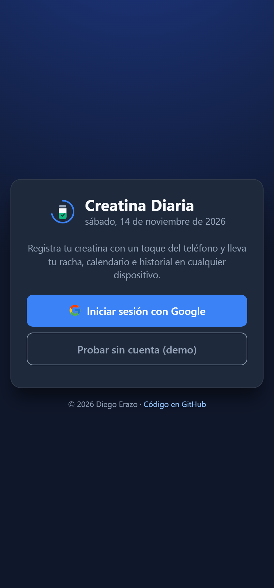
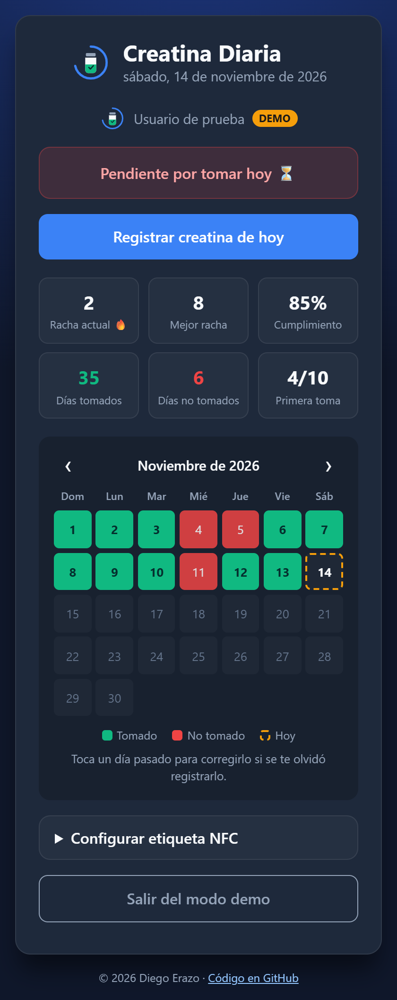
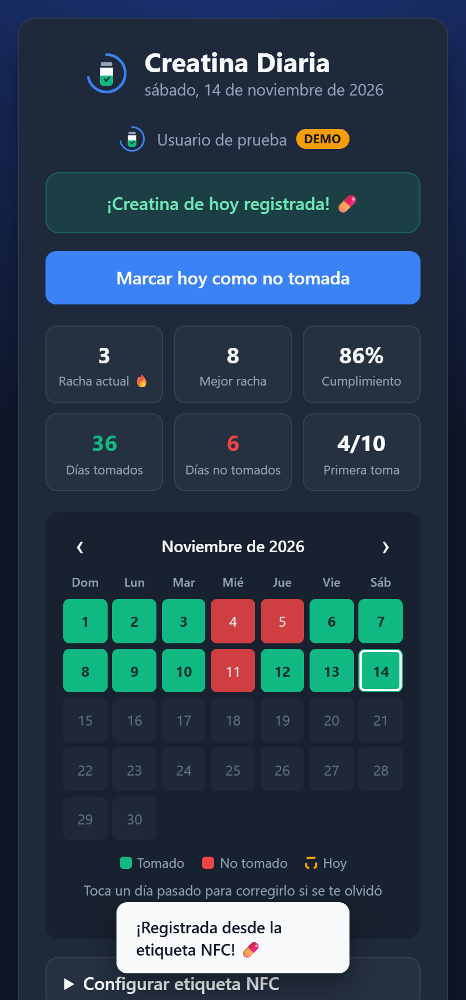

# Creatina Diaria · NFC Tracker

[](https://github.com/DIEGO-erazo/Creatina/actions/workflows/pruebas.yml)


Aplicación web para no olvidar la creatina. Pegas una **etiqueta NFC** en el bote y, al acercar el teléfono, la toma del día queda registrada sola. Muestra tu racha, tu cumplimiento y un calendario de los días tomados y no tomados, sincronizados con tu cuenta de Google.

**Pruébala:** https://diego-erazo.github.io/Creatina/ (botón *Probar sin cuenta* para ver el modo demo).

| Inicio | Panel | Registro por NFC |
|---|---|---|
|  |  |  |

## Características

- **Registro con un toque.** La etiqueta NFC abre la app con `?auto=true` y la toma de hoy se marca sola. Si el día ya estaba marcado, solo lo avisa.
- **Grabar la etiqueta desde la app.** Usa la Web NFC API en Chrome para Android. En otros teléfonos la app muestra el enlace para grabarlo con una app como NFC Tools.
- **Estadísticas:**
  - Racha actual.
  - Mejor racha.
  - Porcentaje de cumplimiento.
  - Días tomados y no tomados.
  - Fecha de la primera toma.
- **Calendario mensual.** Los días se pintan de verde (tomado), rojo (no tomado) o con borde amarillo (hoy pendiente). Puedes tocar un día pasado para corregirlo si olvidaste registrarlo.
- **Cuenta de Google** con Firebase Authentication. Los datos se guardan en Cloud Firestore y se ven en cualquier dispositivo.
- **Funciona sin internet.**
  - La caché local de Firestore guarda los registros y los sincroniza al volver la conexión.
  - Un *service worker* permite abrir la app sin red.
- **Instalable (PWA).** Se puede añadir a la pantalla de inicio como una app.
- **Modo demo** con datos de ejemplo guardados en el navegador, para probarla sin cuenta.

## Cómo usarla con una etiqueta NFC

1. Consigue una etiqueta NFC (NTAG213 o similar, son baratas) y pégala en el bote de creatina.
2. Abre la app en el teléfono e inicia sesión con Google.
3. Abre **Configurar etiqueta NFC → Grabar etiqueta NFC** y acerca la etiqueta a la parte trasera del teléfono.
   - Si tu teléfono no puede grabar desde el navegador (por ejemplo, un iPhone), copia el enlace que muestra la app y grábalo con una app como NFC Tools.
4. Desde ese momento, cada vez que tomes tu creatina acerca el teléfono a la etiqueta y listo.

> Las etiquetas grabadas con la versión 1 (`.../creatina/creatinav1.html?auto=true`) siguen funcionando: esa dirección redirige a la app nueva.

## Tecnologías

| Parte | Tecnología |
|---|---|
| Interfaz | HTML, CSS y JavaScript con módulos ES, sin frameworks ni paso de compilación |
| Autenticación | Firebase Authentication (Google Sign-In con ventana emergente, o redirección si el navegador la bloquea) |
| Datos | Cloud Firestore, con caché local persistente |
| Hardware | Web NFC API (`NDEFReader`) |
| App instalable | Web App Manifest + Service Worker |
| Pruebas | `node:test`, ejecutadas en GitHub Actions con dos zonas horarias |
| Alojamiento | GitHub Pages |

## Estructura

```
index.html              Página única de la app
css/estilos.css         Estilos (tema oscuro, adaptado a móvil)
js/
  registro.js           Lógica pura: fechas locales, estadísticas, rachas y calendario (sin DOM ni Firebase)
  almacen.js            Dónde se guardan los datos: Firebase o el navegador (modo demo), con la misma interfaz
  app.js                Interfaz: eventos, pantalla, registro por NFC
  firebase-config.js    Configuración pública del proyecto de Firebase
sw.js                   Service worker (caché para abrir sin internet)
manifest.webmanifest    Datos para instalar la app
firestore.rules         Reglas de seguridad de Firestore
creatina/creatinav1.html  Dirección antigua, redirige a la app nueva
tests/registro.test.js  Pruebas de la lógica
```

**Modelo de datos.** Hay un documento por usuario en `creatine_users/{uid}`:

```json
{ "logs": ["2026-11-12", "2026-11-13", "2026-11-14"] }
```

Cada fecha es un día en la **hora local** del usuario. Para marcar o desmarcar se usan `arrayUnion` y `arrayRemove`, que cambian un solo día. Así, dos dispositivos no se pisan los datos.

## Ejecutar en local

No necesita instalar dependencias. Basta con servir la carpeta. Los módulos ES no funcionan abriendo el archivo con doble clic.

```bash
python -m http.server 8000
# abre http://localhost:8000
```

El inicio de sesión con Google solo funciona en dominios autorizados en Firebase (`localhost` lo está por defecto). Para probar sin Firebase, usa `http://localhost:8000/?demo`.

### Pruebas

```bash
npm test                          # node --test
TZ=America/El_Salvador npm test   # en otra zona horaria
```

Las pruebas cubren las fechas locales, la racha (hoy pendiente no la rompe), la mejor racha, el cumplimiento, los días no tomados y el armado del calendario.

## Configuración de Firebase (para el dueño del proyecto)

1. **Reglas de seguridad.** Copia [`firestore.rules`](firestore.rules) en *Firebase Console → Firestore Database → Reglas → Publicar*. Con ellas, cada usuario solo puede leer y escribir su propio documento.
2. **Dominios autorizados.** En *Authentication → Settings → Authorized domains* debe estar `diego-erazo.github.io`.
3. **Sobre la `apiKey` del código.** En una app web es un identificador público del proyecto, no una contraseña. La seguridad la dan las reglas de Firestore y los dominios autorizados ([documentación de Firebase](https://firebase.google.com/docs/projects/api-keys)).

## Publicar

GitHub Pages publica la rama `main` desde la raíz. Después de cambiar archivos de la app, sube la constante `VERSION` en `sw.js` para que los teléfonos descarguen la versión nueva.

## Historial

Los cambios por versión están en [CHANGELOG.md](CHANGELOG.md).

## Autor y licencia

Creado por **Diego Erazo**, estudiante de Ingeniería en Sistemas y Computación en la Universidad Dr. Andrés Bello, El Salvador ([GitHub](https://github.com/DIEGO-erazo)).

© 2026 Diego Erazo. **Todos los derechos reservados.**

- Usar la app publicada es libre.
- El código está a la vista como portafolio. No se permite copiarlo, modificarlo ni redistribuirlo sin permiso escrito.

Las condiciones completas están en [LICENSE](LICENSE).

---

### About (English)

A web app that logs a daily creatine dose when you tap your phone on an NFC tag stuck to the tub.

- Shows the current and best streak, the adherence rate and a monthly calendar.
- Data syncs through Firebase Authentication (Google Sign-In) and Cloud Firestore, with offline persistence.
- Installable as a PWA.
- The app writes the NFC tag itself with the Web NFC API.
- Plain HTML, CSS and JavaScript (ES modules), with unit tests on `node:test` running in GitHub Actions.

© 2026 Diego Erazo, all rights reserved.
